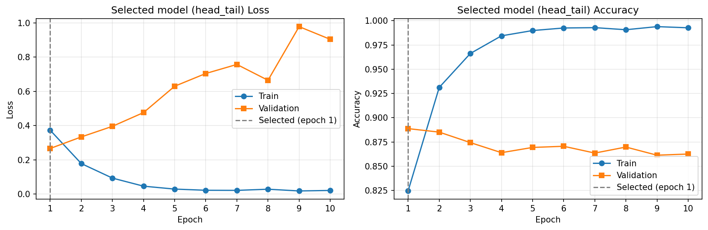
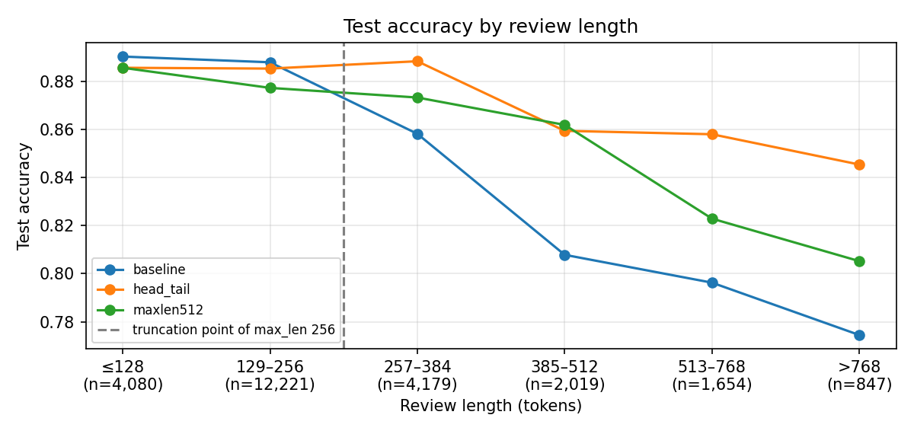

# Transformer for IMDb Sentiment Classification

An encoder-only Transformer written from scratch in PyTorch for binary sentiment classification of IMDb movie reviews. It does not use `nn.Transformer`, `nn.MultiheadAttention` or Hugging Face model classes.

With the configuration the assignment specifies, the model reaches **0.8669 test accuracy** (F1 0.8691). The best variant, chosen by validation loss, keeps both the start and the end of long reviews and reaches **0.8805 test accuracy** (F1 0.8844).

This is Assignment 3 for the Applied AI/ML 2 course, by Wimukthi Rajapaksha (a1988198).

## Repository contents

| Path | Description |
|---|---|
| [`assignment-3_wimukthi_a1988198.ipynb`](assignment-3_wimukthi_a1988198.ipynb) | Full pipeline with saved outputs: data, model, training, experiments and error analysis |
| [`assignment-3_wimukthi_a1988198.pdf`](assignment-3_wimukthi_a1988198.pdf) | Report: methods, mathematical formulation, analysis of the results and answers to the assignment questions |
| [`experiment_summary.csv`](experiment_summary.csv) | Configuration, metrics and cost of each seed-42 experiment |
| [`figures/`](figures/) | Plots generated by the notebook |

## Model

```
Input → Embedding → Positional Encoding → 2 × [Multi-Head Self-Attention → Feed-Forward] → Masked Mean Pooling → Linear → Softmax
```

| Setting | Value |
|---|---|
| Embedding size (`d_model`) | 128 |
| Encoder blocks | 2 (Post-LN) |
| Attention heads | 4 |
| Feed-forward size | 256, ReLU |
| Dropout | 0.1 |
| Vocabulary | 20,000 tokens, built from the training split only |
| Maximum review length | 256 tokens |
| Parameters | 2,825,218 |

**Training:** Adam (learning rate 0.001), batch size 32, 10 epochs, cross-entropy over the two classes, gradient clipping at norm 1.0.

**Data:** the official 25,000-review training set is split 80/20 into 20,000 training and 5,000 validation reviews. The 25,000-review test set is used only for final evaluation.

**Model selection:** each run keeps the checkpoint with the lowest validation loss, and the final model is the run with the lowest validation loss. The test set plays no part in either choice.

## Results

Test-set results for seed 42, from [`experiment_summary.csv`](experiment_summary.csv). Each experiment changes only the listed factors compared with the baseline.

| Experiment | Change from baseline | Best val. loss | Test accuracy | Test F1 | Median s/epoch |
|---|---|---|---:|---:|---:|
| `baseline` | None (assignment configuration) | 0.2902 | 0.8669 | 0.8691 | 12.5 |
| `no_padding_mask` | Padding mask removed from attention and pooling | 0.2945 | 0.8598 | 0.8657 | 11.4 |
| `dynamic_padding` | Per-batch padding and length bucketing | 0.2999 | 0.8570 | 0.8646 | 9.8 |
| `dynamic_padding_amp` | Dynamic padding and fp16 mixed precision | 0.3013 | 0.8580 | 0.8658 | 8.1 |
| **`head_tail` (selected)** | **Keep the first 64 and last 192 tokens** | **0.2665** | **0.8805** | **0.8844** | **12.6** |
| `maxlen512` | `max_len` 512, dynamic padding and mixed precision | 0.2759 | 0.8706 | 0.8768 | 11.6 |
| `regularised` | Dropout 0.3 and AdamW weight decay 0.1 | 0.2904 | 0.8639 | 0.8641 | 12.7 |
| `regularised_warmup_cosine` | Regularised, plus warm-up and cosine decay | 0.3379 | 0.8326 | 0.8130 | 12.7 |

All runs used a Google Colab Tesla T4 GPU, so the timings apply to that hardware.

### Variation across seeds

The baseline and the two best changes were repeated with seeds 42, 1 and 2:

| Configuration | Best val. loss | Test accuracy | Test F1 | Test accuracy vs baseline (Welch's *p*) |
|---|---:|---:|---:|---:|
| Baseline | 0.2939 ± 0.0124 | 0.8599 ± 0.0117 | 0.8547 ± 0.0205 | n/a |
| Head + tail | 0.2670 ± 0.0014 | 0.8776 ± 0.0038 | 0.8756 ± 0.0088 | +0.0177 (0.109) |
| `max_len` 512 | 0.2682 ± 0.0085 | 0.8744 ± 0.0035 | 0.8753 ± 0.0013 | +0.0145 (0.155) |

All six runs of the two truncation fixes beat all three baseline runs, but with three seeds the differences are not statistically significant.

### Main findings

- **Truncation:** 36.2% of training reviews are longer than 256 tokens. On those test reviews, head + tail truncation raises accuracy from 0.8265 to 0.8716 at about the same training time.
- **Training efficiency:** dynamic padding with mixed precision trains about 1.55× faster per epoch than the baseline. Mixed precision also cuts training memory from 271 MB to 208 MB.
- **Overfitting:** validation loss is lowest at epoch 1 for the baseline and rises to 1.3472 by epoch 10, while training accuracy stays above 0.99 from epoch 6. Regularisation slows this rise but gives no better best checkpoint.

| Selected model training curves | Accuracy by review length |
|---|---|
|  |  |

The full analysis is in the [report](assignment-3_wimukthi_a1988198.pdf).

## Running the notebook

A GPU is recommended. The notebook picks CUDA, then Apple-silicon MPS, then CPU. Mixed precision is used on CUDA only, so `dynamic_padding_amp` is skipped on MPS and CPU.

**On Google Colab:**

1. Open the notebook and select a GPU runtime (Runtime → Change runtime type → T4 GPU).
2. Run the first code cell.
3. If that cell installs `torchtext`, it restarts the session on purpose. Wait for the restart.
4. Use Run all.

**Locally:**

```bash
pip install torch numpy pandas matplotlib scipy datasets jupyter
jupyter notebook assignment-3_wimukthi_a1988198.ipynb
```

The first code cell tries to install `torch==2.3.0`, `torchtext==0.18.0` and `numpy<2`, so use a virtual environment if you run it locally. `torchtext` needs Python 3.12 or older. If it can't be installed, the notebook falls back to a re-implementation of the same `basic_english` tokeniser rules. The saved run used this fallback, with PyTorch 2.11 on Python 3.13.

The IMDb dataset downloads automatically from Hugging Face (`stanfordnlp/imdb`). Plots are written to `figures/`, checkpoints to `checkpoints/` and the summary table to `experiment_summary.csv`. To shorten a run, set `RUN_EXPERIMENTS = False` to skip the experiments and `RUN_SEED_REPEATS = False` to skip the seed repeats.
